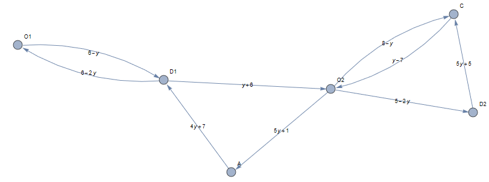
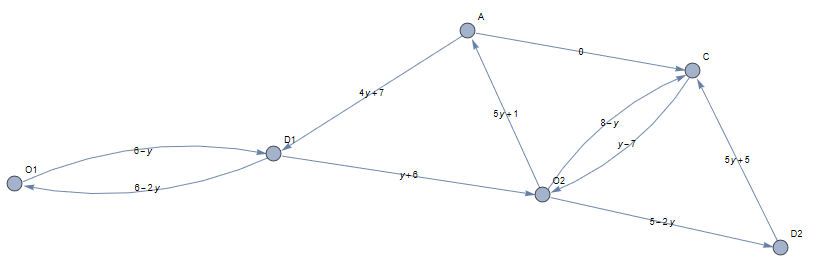
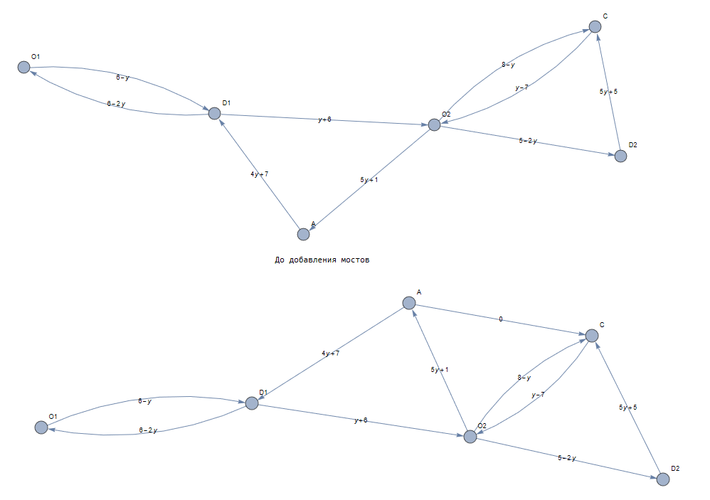

# Traffic Flow Modeling: Wardrop Equilibrium

Математическое моделирование транспортных потоков и исследование равновесия по Вардропу с использованием Wolfram Mathematica.

## О проекте

Проект посвящён исследованию распределения транспортных потоков в дорожной сети с использованием теории графов и методов математической оптимизации.

В рамках работы реализовано построение транспортных сетей, поиск маршрутов, формирование оптимизационной модели и исследование изменения структуры сети при добавлении новых мостов.

## Цель проекта

Разработать математическую модель транспортной сети для исследования распределения потоков по принципу Вардропа и анализа влияния новых транспортных связей на характеристики сети.

## Реализованные возможности

- Построение ориентированного графа транспортной сети.
- Задание функций транспортных затрат на рёбрах.
- Поиск маршрутов между вершинами.
- Формирование целевой функции и ограничений задачи оптимизации.
- Численные расчёты в Wolfram Mathematica.
- Добавление новых связей с помощью функции `addZeroBridges`.
- Визуализация исходного и изменённого графов.
- Сравнение характеристик транспортных сетей.

## Математическая модель

В основе исследования лежит первый принцип Вардропа: в равновесном состоянии все используемые маршруты между заданными пунктами имеют одинаковые минимальные транспортные затраты.

Транспортная сеть представляется ориентированным графом, рёбрам которого сопоставляются функции затрат, зависящие от величины транспортного потока.

Для определения распределения потоков формируется задача математической оптимизации с ограничениями.

## Визуализация

### Исходная транспортная сеть

Граф создаётся с помощью функции `createTransportGraph`.

### Сеть после добавления моста

С помощью функции `addZeroBridges` изменяется структура сети. В представленном примере добавлена связь между вершинами A и C.

### Сравнение сетей

В работе реализовано построение и сопоставление транспортных сетей до и после добавления новых связей.

## Результаты

Реализована программная модель транспортной сети, позволяющая строить графы, задавать функции затрат, выполнять численные расчёты и исследовать влияние дополнительных связей.

Корректность отдельных результатов численной оптимизации требует дополнительной проверки.

## Технологии

- Wolfram Mathematica
- Wolfram Language
- Теория графов
- Математическое моделирование
- Численные методы оптимизации

## Структура проекта

- `wardrop_equilibrium.nb` — исходный ноутбук с математической моделью и вычислениями.
- `images/` — визуализации транспортных сетей.
- `README.md` — описание проекта.

## Запуск

1. Открыть файл `wardrop_equilibrium.nb` в Wolfram Mathematica.
2. Последовательно выполнить вычислительные ячейки ноутбука.

## Статус

Учебный проект. Построение и модификация транспортных сетей реализованы; численные результаты требуют дополнительной проверки.
